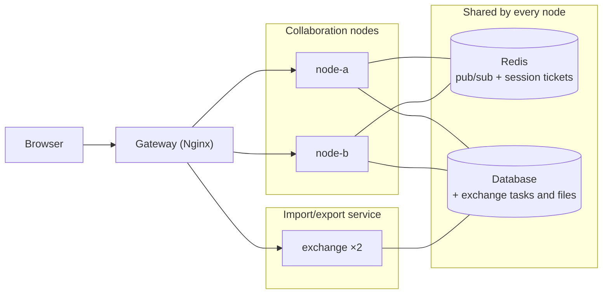

# Multi-node deployment

English | [简体中文](./README.zh-CN.md)

Run several collaboration server nodes behind one gateway. The nodes share one database and one Redis: Redis carries real-time messages between nodes and holds session tickets, so any node can serve any request. `@univerjs-pro/collaboration-cluster-redis` provides the Redis adapters.

This example runs two collaboration nodes, two replicas of a separate import/export (exchange) service, PostgreSQL, Redis, and Nginx with Docker Compose, plus a small Sheet creation and file list UI to observe routing, try collaborative editing, and import or export XLSX files.

## Deployment



- **Collaboration nodes** run the same code with the same `DATABASE_URL` and the same `REDIS_URL`. Add or remove nodes freely; nothing is pinned to a node.
- **Redis** needs version 6.2 or later. Run it highly available: when Redis is unavailable, ticket requests fail and WebSocket connections are rejected with a retryable `503`.
- **Database** must be reachable by every collaboration node and satisfy the SDK database adapter contract. The example uses PostgreSQL through [`server/postgres-database-adapter.ts`](./server/postgres-database-adapter.ts), a copy of the custom adapter from the [`database-adapter`](../database-adapter/README.md) example; the application file catalog lives in the same database. The nodes do not create tables: [`schema.sql`](./schema.sql) is applied once when PostgreSQL initializes its data directory, and each node only checks on startup that the tables exist. Beyond the example, manage that schema with your migration tool and run migrations as a separate deployment step rather than from the service.
- **Import/export service** is a second entry point of the same code base, [`server/exchange-main.ts`](./server/exchange-main.ts), deployed separately from the collaboration nodes and scaled on its own, see [Run import and export separately](#run-import-and-export-separately). It connects to the same `DATABASE_URL` and does not use Redis.
- **Gateway** sends a document's WebSocket and submissions to one node, exchange paths to the exchange replicas, and spreads everything else, see [Configure the gateway](#configure-the-gateway). Replace Nginx with any gateway or load balancer; on Kubernetes, let the platform manage replicas and apply the same routing rules.

## Set up every collaboration node

Install the adapter package and a Redis client next to the Endpoint:

```bash
pnpm add @univerjs-pro/collaboration-endpoint @univerjs-pro/collaboration-cluster-redis redis
```

[`server/main.ts`](./server/main.ts) creates one Redis connection for commands and a duplicate for subscriptions, builds both adapters, and passes them to the Endpoint:

```ts
const redis = createClient({ url: redisURL });
const redisSubscriber = redis.duplicate();
await Promise.all([redis.connect(), redisSubscriber.connect()]);
const pubSub = new RedisPubSubAdapter({ pubClient: redis, subClient: redisSubscriber });
const ticketStore = new RedisSessionTicketStore({ client: redis });
const endpoint = new UniverCollabEndpoint(service, { pubSub, ticketStore });
```

`ioredis` and Redis Cluster are also supported, see the `@univerjs-pro/collaboration-cluster-redis` README.

The Endpoint does not dispose the adapters or the clients it was given. Shut down in reverse order of creation: dispose the transport, then the pub/sub adapter, then close both Redis connections.

## Configure the gateway

Keep a document's WebSocket and submissions on one node: acknowledgements and broadcasts are then delivered locally, and only that node loads the document into memory. Everything else can go to any node.

Submission paths already contain the unitID. The WebSocket path does not, so [`web/main.ts`](./web/main.ts) adds a `unit` query parameter that the SDK preserves:

```ts
const routingQuery = new URLSearchParams({ unit: unitID }).toString();
const connectionConfig = {
  collabWebSocketUrl: `${wsProtocol}://${location.host}/universer-api/comb/connect?${routingQuery}`,
  wsSessionTicketUrl: `${baseURL}/user/session-ticket`,
};
```

[`nginx.conf`](./nginx.conf) maps both to one routing key and distributes with `hash $routing_unit consistent`:

| Request | Distribution |
| --- | --- |
| WebSocket `/universer-api/comb/connect` | Consistent hashing by query `unit` |
| Collaboration submission `new_changes` | Consistent hashing by path `unitID` |
| Ticket, snapshot, block, fetchmissing | Round robin |
| Pages, file creation and listing, authorization | Round robin |
| Upload `/universer-api/stream/file/upload`, `/universer-api/exchange/`, `/universer-api/file/` | Round robin across the exchange replicas |

The `unit` parameter must match the current document ID; the example opens one document per page and reconnects when switching files. The application checks access permissions. If your gateway keeps idle upstream connections open, set its idle timeout below the Node.js server's keep-alive timeout (5 seconds by default) to avoid occasional `502` responses.

The exchange upstream uses `server exchange:3011 resolve` with Docker's DNS so that Nginx follows the replica set as it changes; the exchange locations raise `client_max_body_size` to `32m` for uploads. Every exchange response carries an `X-Exchange-Instance` header naming the replica that handled it.

Nginx references: [hash](https://nginx.org/en/docs/http/ngx_http_upstream_module.html#hash), [resolve](https://nginx.org/en/docs/http/ngx_http_upstream_module.html#resolve), and [WebSocket proxying](https://nginx.org/en/docs/http/websocket.html).

## Run import and export separately

Server-side import and export use `@univerjs-pro/exchange-node`, whose converter is a native Rust binding of roughly 29 MB per platform. A conversion is CPU-bound and holds the whole workbook in memory, while a collaboration node mostly waits on sockets and keeps many small documents resident. The two have different resource profiles and different load curves, so the example runs the exchange routes in their own service:

- it scales on its own: `deploy.replicas: 2` with `cpus: 1` and `memory: 1g` in [`compose.yaml`](./compose.yaml), independent of the number of collaboration nodes;
- a long or failing conversion does not slow down or crash a node that is serving WebSockets;
- the collaboration image does not ship the native binding (see the `collab` target in [`Dockerfile`](./Dockerfile)).

[`server/exchange-main.ts`](./server/exchange-main.ts) wires only the database adapter, `UniverCollabService`, and the exchange router: no Endpoint, Transport, or Redis. Import creates the Unit through `createUnitFromSnapshot()` and registers it in the file catalog; export reads the latest confirmed revision through `getUnitLoadDataWithBlocks()` and `UnitSnapshotMaterializer`, without involving the node that currently hosts the document.

[`server/exchange.ts`](./server/exchange.ts) implements the protocol expected by `UniverExchangeClientPlugin`: upload, `import`/`export` returning a task ID, task polling, signed URL, and download. All of its state lives in two PostgreSQL tables from [`schema.sql`](./schema.sql), accessed through [`server/exchange-store.ts`](./server/exchange-store.ts):

| Table | Content |
| --- | --- |
| `exchange_tasks` | `pending` → `running` → `done` (with `result`) or `failed` (with `error`) |
| `exchange_files` | Uploaded source files, deleted after import, and exported results |

Because the replica that accepts an upload or starts a task writes to the shared database, any replica can answer the poll for that task or serve the download, which is what allows plain round robin at the gateway. Watch `X-Exchange-Instance` in the browser's network panel to see different replicas handling the upload, the poll, and the download of one import.

The example keeps one simplification: conversion runs synchronously inside the replica that accepted the request. To split further, keep the same two tables, store file bytes in object storage instead of a `bytea` column, and turn `startTask()` into a queue publish consumed by dedicated worker processes that scale on their own. If a replica stops mid-conversion, its tasks stay `running`; a worker design adds leases or timeouts so another worker can pick them up.

## Run the example

Install Docker with Docker Compose, then run from the repository root:

```bash
docker compose -f examples/multi-node/compose.yaml up --build --force-recreate
```

Alternatively, run `pnpm example:multi-node`. Dependencies and builds run inside the containers. If you use standalone Compose, replace `docker compose` with `docker-compose`.

Open <http://127.0.0.1:3010/>:

1. Click **New Sheet** to create a file. The sidebar shows the node assigned to it, `node-a` or `node-b`.
2. Copy the complete URL into another tab, edit the same Sheet, and check synchronization.
3. Create more files and repeat with one assigned to the other node.
4. With a file open, use **File → Open (File)** to import an XLSX/XLS/CSV/TSV file. The import creates a new Unit named after the file, lists it in the sidebar, and the notification links to it. Use **File → Save As** to export the current Sheet as XLSX/CSV/TSV.

Set `GATEWAY_PORT` to change the default port of `3010`, or `UNIVER_LICENSE` to supply a license at build time. After code changes, rerun the startup command to recreate both the server nodes and Nginx, preventing stale container addresses in the gateway. Reopen the page afterward.

## Scope

- The node topology is fixed: Nginx does not retry a request on another node, and the example does not provide automatic failover.
- The example uses a fixed user and demo permissions and covers Sheet collaboration only.
- Import and export convert inside the exchange replica that accepted the request, keep file bytes in PostgreSQL, and serve unsigned download URLs. These are teaching choices; see [Run import and export separately](#run-import-and-export-separately) for how to split further.

## Logs and shutdown

```bash
# View node and exchange logs
docker compose -f examples/multi-node/compose.yaml logs -f node-a node-b exchange

# Stop services and preserve data
docker compose -f examples/multi-node/compose.yaml down
```

Add `--volumes` to the stop command to erase the demo data.
