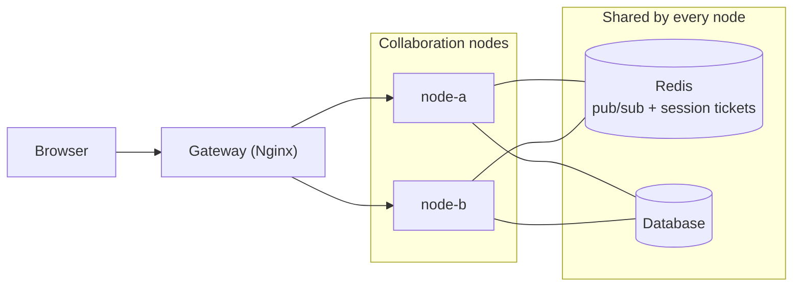

# Multi-node deployment

English | [简体中文](./README.zh-CN.md)

Run several collaboration server nodes behind one gateway. The nodes share one database and one Redis: Redis carries real-time messages between nodes and holds session tickets, so any node can serve any request. `@univerjs-pro/collaboration-cluster-redis` provides the Redis adapters.

This example runs two nodes, Redis, and Nginx with Docker Compose, plus a small Sheet creation and file list UI to observe routing and try collaborative editing.

## Deployment



- **Nodes** run the same code with the same database and the same `REDIS_URL`. Add or remove nodes freely; nothing is pinned to a node.
- **Redis** needs version 6.2 or later. Use a highly available Redis in production: when Redis is unavailable, ticket requests fail and WebSocket connections are rejected with a retryable `503`.
- **Database** must be reachable by every node and satisfy the SDK database adapter contract. The example shares a SQLite volume on one host.
- **Gateway** sends a document's WebSocket and submissions to one node and spreads everything else, see [Configure the gateway](#configure-the-gateway). Replace Nginx with any gateway or load balancer; on Kubernetes, let the platform manage replicas and apply the same routing rules.

## Set up every node

Install the adapter package and a Redis client next to the Endpoint:

```bash
pnpm add @univerjs-pro/collaboration-endpoint @univerjs-pro/collaboration-cluster-redis redis
```

[`server/main.ts`](./server/main.ts) creates one Redis connection for commands and a duplicate for subscriptions, builds both adapters, and passes them to the Endpoint:

```ts
const redis = createClient({ url: redisURL });
const redisSubscriber = redis.duplicate();
await Promise.all([redis.connect(), redisSubscriber.connect()]);
const pubSub = new RedisPubSubAdapter({ pubClient: redis, subClient: redisSubscriber });
const ticketStore = new RedisSessionTicketStore({ client: redis });
const endpoint = new UniverCollabEndpoint(service, { pubSub, ticketStore });
```

`ioredis` and Redis Cluster are also supported, see the `@univerjs-pro/collaboration-cluster-redis` README.

The Endpoint does not dispose the adapters or the clients it was given. Shut down in reverse order of creation: dispose the transport, then the pub/sub adapter, then close both Redis connections.

## Configure the gateway

Keep a document's WebSocket and submissions on one node: acknowledgements and broadcasts are then delivered locally, and only that node loads the document into memory. Everything else can go to any node.

Submission paths already contain the unitID. The WebSocket path does not, so [`web/main.ts`](./web/main.ts) adds a `unit` query parameter that the SDK preserves:

```ts
const routingQuery = new URLSearchParams({ unit: unitID }).toString();
const connectionConfig = {
  collabWebSocketUrl: `${wsProtocol}://${location.host}/universer-api/comb/connect?${routingQuery}`,
  wsSessionTicketUrl: `${baseURL}/user/session-ticket`,
};
```

[`nginx.conf`](./nginx.conf) maps both to one routing key and distributes with `hash $routing_unit consistent`:

| Request | Distribution |
| --- | --- |
| WebSocket `/universer-api/comb/connect` | Consistent hashing by query `unit` |
| Collaboration submission `new_changes` | Consistent hashing by path `unitID` |
| Ticket, snapshot, block, fetchmissing | Round robin |
| Pages, file creation and listing, authorization | Round robin |

The `unit` parameter must match the current document ID; the example opens one document per page and reconnects when switching files. The application checks access permissions. If your gateway keeps idle upstream connections open, set its idle timeout below the Node server's keep-alive timeout (5 seconds by default) to avoid occasional `502` responses.

Nginx references: [hash](https://nginx.org/en/docs/http/ngx_http_upstream_module.html#hash) and [WebSocket proxying](https://nginx.org/en/docs/http/websocket.html).

## Run the example

Install Docker with Docker Compose, then run from the repository root:

```bash
docker compose -f examples/multi-node/compose.yaml up --build --force-recreate
```

Alternatively, run `pnpm example:multi-node`. Dependencies and builds run inside the containers. If you use standalone Compose, replace `docker compose` with `docker-compose`.

Open <http://127.0.0.1:3010/>:

1. Click **New Sheet** to create a file. The sidebar shows the node assigned to it, `node-a` or `node-b`.
2. Copy the complete URL into another tab, edit the same Sheet, and check synchronization.
3. Create more files and repeat with one assigned to the other node.

Set `GATEWAY_PORT` to change the default port of `3010`, or `UNIVER_LICENSE` to supply a license at build time. After code changes, rerun the startup command to recreate both the server nodes and Nginx, preventing stale container addresses in the gateway. Reopen the page afterward.

## Scope

- The node topology is fixed: Nginx does not retry a request on another node, and the example does not provide automatic failover.
- The example uses a fixed user and demo permissions and covers Sheet collaboration only.

## Logs and shutdown

```bash
# View node logs
docker compose -f examples/multi-node/compose.yaml logs -f node-a node-b

# Stop services and preserve data
docker compose -f examples/multi-node/compose.yaml down
```

Add `--volumes` to the stop command to erase the demo data.
