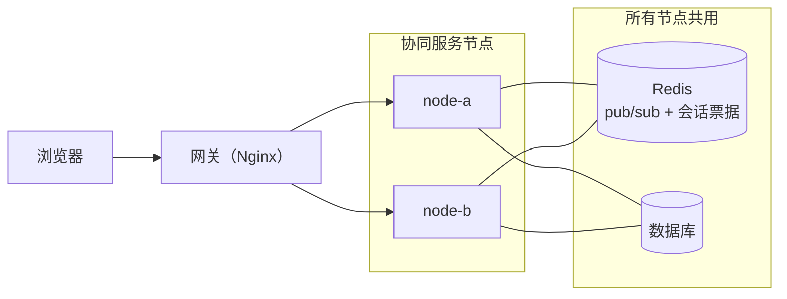

# 多节点部署

[English](./README.md) | 简体中文

在一个网关后面运行多个协同服务节点。所有节点共用一个数据库和一个 Redis：Redis 负责在节点之间传递实时消息并保存会话票据，因此任何节点都能处理任何请求。`@univerjs-pro/collaboration-cluster-redis` 提供了 Redis 适配器。

本例用 Docker Compose 运行两个协同服务节点、PostgreSQL、Redis 和 Nginx，并提供简单的 Sheet 创建和文件列表，方便观察路由和验证多人协同。

## 部署结构



- **协同服务节点**运行同样的代码，连接同一个 `DATABASE_URL` 和同一个 `REDIS_URL`。节点可以随时增减，没有任何状态绑定在某个节点上。
- **Redis** 需要 6.2 及以上。生产环境使用高可用的 Redis：Redis 不可用时，签票请求失败，WebSocket 建连返回可重试的 `503`。
- **数据库**必须让所有协同服务节点都能访问，并满足 SDK 数据库适配器契约。本例使用 PostgreSQL，适配器为 [`server/postgres-database-adapter.ts`](./server/postgres-database-adapter.ts)，复制自 [`database-adapter`](../database-adapter/README.zh-CN.md) 示例中的自定义适配器；应用的文件目录表也放在同一个数据库中。节点不负责建表：[`schema.sql`](./schema.sql) 在 PostgreSQL 首次初始化数据目录时执行一次，节点启动时只检查表是否存在。生产环境请用迁移工具管理这份 schema，并把迁移作为独立的部署步骤执行，而不是由服务自己建表。
- **网关**把同一文档的 WebSocket 和提交发到同一个节点，其余请求随意分配，见[配置网关](#配置网关)。可以换成任何网关或负载均衡；使用 Kubernetes 时由平台管理副本，套用同样的路由规则。

## 配置每个协同服务节点

在 Endpoint 旁边安装适配器包和 Redis 客户端：

```bash
pnpm add @univerjs-pro/collaboration-endpoint @univerjs-pro/collaboration-cluster-redis redis
```

[`server/main.ts`](./server/main.ts) 创建一个 Redis 连接用于命令，再复制一个专门用于订阅，构造两个适配器后传给 Endpoint：

```ts
const redis = createClient({ url: redisURL });
const redisSubscriber = redis.duplicate();
await Promise.all([redis.connect(), redisSubscriber.connect()]);
const pubSub = new RedisPubSubAdapter({ pubClient: redis, subClient: redisSubscriber });
const ticketStore = new RedisSessionTicketStore({ client: redis });
const endpoint = new UniverCollabEndpoint(service, { pubSub, ticketStore });
```

也支持 `ioredis` 和 Redis Cluster，见 `@univerjs-pro/collaboration-cluster-redis` 的 README。

### 许可证

每个节点从 `UNIVER_LICENSE` 和 `UNIVER_LICENSE_KEY` 读取同一份许可证。许可证要覆盖运行的
节点数，本例是两个。单节点许可证配合 `pubSub` 启动时，节点以 `LICENSE_POLICY_INVALID` 停止。运行的节点多于许可证覆盖的数量时，
最新加入的节点在宽限期后下线；[`server/main.ts`](./server/main.ts) 记录每次变化：

```ts
endpoint.license.on("nodesStatusChanged", ({ status, previousStatus, limit, reason }) => {
  console.warn(`[${NODE_ID}] license.nodes ${previousStatus} -> ${status} limit=${limit}${reason ? ` reason=${reason}` : ""}`);
});
```

Endpoint 不会释放外部传入的适配器和客户端。停止服务时按创建的反序释放：先释放 Transport，再释放 pub/sub 适配器，最后关闭两个 Redis 连接。

## 配置网关

把同一文档的 WebSocket 和提交固定到一个节点：提交确认和广播在本地直接推送，并且只有这个节点把文档加载进内存。其余请求发到任何节点都可以。

提交请求的路径已经包含 unitID。WebSocket 的路径不含，所以 [`web/main.ts`](./web/main.ts) 给它追加 `unit` 参数，SDK 会保留这个参数：

```ts
const routingQuery = new URLSearchParams({ unit: unitID }).toString();
const connectionConfig = {
  collabWebSocketUrl: `${wsProtocol}://${location.host}/universer-api/comb/connect?${routingQuery}`,
  wsSessionTicketUrl: `${baseURL}/user/session-ticket`,
};
```

[`nginx.conf`](./nginx.conf) 把两者映射成同一个路由键，用 `hash $routing_unit consistent` 分配：

| 请求 | 分配方式 |
| --- | --- |
| WebSocket `/universer-api/comb/connect` | 按 query `unit` 一致性哈希 |
| 协同提交 `new_changes` | 按路径 `unitID` 一致性哈希 |
| ticket、snapshot、block、fetchmissing | 轮询 |
| 页面、文件创建与列表、鉴权 | 轮询 |

`unit` 必须与当前文档 ID 一致；本例每个页面打开一份文档，切换文件时重新建连。访问权限由应用校验。如果网关会保持与上游的空闲连接，空闲超时要短于 Node.js 服务的 keep-alive 超时（默认 5 秒），否则会偶发 `502`。

Nginx 指令参考：[一致性哈希](https://nginx.org/en/docs/http/ngx_http_upstream_module.html#hash)、[WebSocket 代理](https://nginx.org/en/docs/http/websocket.html)。

## 运行示例

准备 Docker、Docker Compose 和覆盖两个节点的许可证，在仓库根目录执行：

```bash
export UNIVER_LICENSE="$(cat license.txt)"
export UNIVER_LICENSE_KEY="$(cat licenseKey.txt)"
```


```bash
docker compose -f examples/multi-node/compose.yaml up --build --force-recreate
```

也可以运行 `pnpm example:multi-node`，依赖安装和构建都在容器内完成。使用独立 Compose 的环境，将 `docker compose` 替换为 `docker-compose`。

打开 <http://127.0.0.1:3010/>：

1. 点击 **New Sheet** 创建文件，侧栏会显示它分配到的节点，`node-a` 或 `node-b`。
2. 把完整 URL 复制到另一个标签页，编辑同一份 Sheet，观察同步。
3. 再创建几份文件，选择分配到另一节点的文件重复验证。

`GATEWAY_PORT` 可修改默认端口 `3010`；Compose 把 `UNIVER_LICENSE` 交给浏览器构建，把两个变量都交给节点。更新代码后重新执行启动命令，会同时重建服务节点和 Nginx，避免网关保留旧容器地址；随后重新打开页面。

## 示例范围

- 节点拓扑固定：Nginx 不会把请求改发到另一个节点，示例也不提供自动故障接管。
- 使用固定用户和演示权限，只覆盖 Sheet 协同。

## 日志与停止

```bash
# 查看节点日志
docker compose -f examples/multi-node/compose.yaml logs -f node-a node-b

# 停止服务，保留数据
docker compose -f examples/multi-node/compose.yaml down
```

需要清空演示数据时，在停止命令中加上 `--volumes`。
